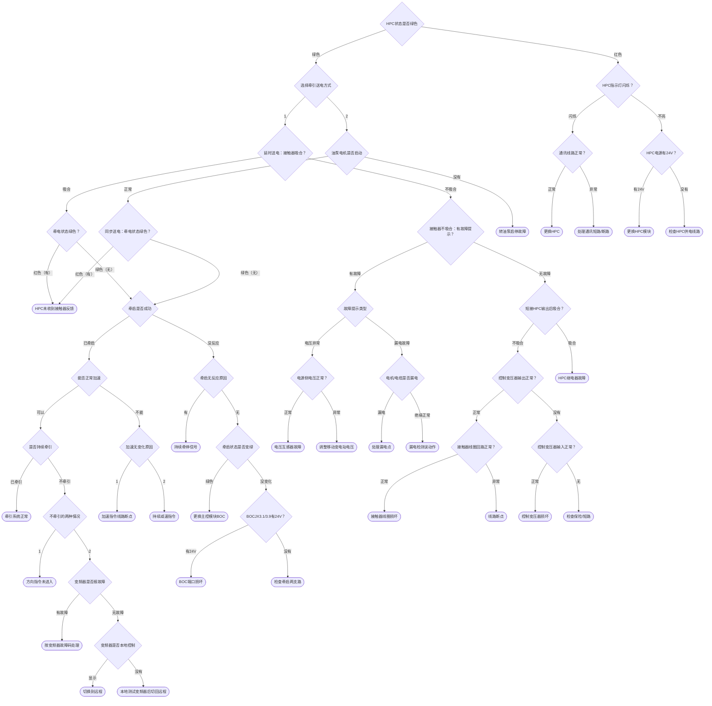

# 采煤机系统牵引故障诊断树

> 由 `系统牵引故障.mp4` 录屏提取。程序实现时以 `diagnosis-tree.yaml` 为唯一业务逻辑数据源。

## 系统牵引故障调试说明

### 采煤机制动系统小知识

采煤机送电等待系统就绪后，依次启动油泵电机、牵启、设定速度和设定方向。牵引模块向主变频器（左）发送速度和方向指令，两个变频器通过主从控制方式同步输出一定的转矩。同时，变频器通过 RS485 通讯线向牵引模块发出松闸指令，牵引模块 HPCJX2.5 和 HPCJX2.9 继电器触点闭合，制动电磁阀得电并打开制动器油路。2.5 MPa 油压在推开制动器的同时触发压力继电器动作。压力继电器动作后，常开触点 1 和 3 闭合，本安 +12V 通过压力继电器 1、3 之间的触点到牵引模块 HPCJX3.4，HPCJX3.3 到本安 0V 形成回路，屏幕上显示的“未松闸”变为“已松闸”。牵引模块 HPCJX2.10 和 HPCJX2.11 继电器常开触点闭合，主变频器内部 +24V 通过 HPCJX2.10、HPCJX2.11 之间的触点到主变频器松闸确认端口（默认 DI5），变频器收到松闸确认信号后开始正常运行。变频器从发出松闸指令到收到松闸确认信号的允许时间为 2 秒；超过 2 秒仍未收到确认，主变频器停止运行，并通过 RS485 发出关闭松闸指令端口命令，同时报故障（ACS800：FF74；ACS880：71A3）。松闸确认信号只能在变频器发出松闸指令后的 2 秒内反馈；主变频器未运行、处于待机状态时收到松闸确认信号，也会报故障（ACS800：FF74；ACS880：71A2）。

信号链可概括为：

```text
牵引模块 → 主变频器（左） → 主从控制同步输出转矩
变频器 RS485 松闸指令 → HPCJX2.5 / HPCJX2.9 → 制动电磁阀 → 2.5 MPa 油压 → 压力继电器
压力继电器 1、3 闭合 → HPCJX3.4 / HPCJX3.3 → 屏幕“已松闸”
HPCJX2.10 / HPCJX2.11 → 主变频器 DI5 松闸确认 → 变频器正常运行
```

### 安全提示

本资料用于复刻原小程序的诊断逻辑，不替代矿方安全规程、设备说明书或专业人员判断。涉及 24V、220V、380V/660V 测量、绝缘测试、短接触点、拆装插头等操作时，必须由具备资质的人员执行停电、验电、放电、闭锁挂牌等措施。原页面中的“临时短接”内容仅按录屏原文保留，不应被 AI 或小程序视为可直接执行的操作授权。

## 文件与逻辑说明

- 共提取 **27 个问题节点**、**26 个结论节点**、**38 条完整根到结论路径**。
- 所有业务跳转均在录屏中直接观察确认，没有擅自补写未录制分支。
- “上一步”通过页面历史栈统一实现，不写入业务选项。

## q01｜问题

采煤机上电后等待显示器进入正常监视画面，观察屏幕上HPC状态是否为绿色？

来源：`P001`，约 `0.0s`，截图 `source-frames/q01.jpg`。

| 选项 | 下一节点 | 状态 |
|---|---|---|
| 绿色 | `q02` | `observed` |
| 红色 | `q25` | `observed` |

## q02｜问题

HPC模块状态绿色代表HPC工作正常，和控制系统之间通讯正常。如果遥控器和端头站不能正常操作采煤机，请先使用机身按钮配合处理故障。待机身按钮可以正常操作煤机后再另行处理遥控器或端头站故障。请选择牵引送电方式：1.延时自动送电；2.和油泵电机一同启动。

来源：`P002`，约 `3.0s`，截图 `source-frames/q02.jpg`。

| 选项 | 下一节点 | 状态 |
|---|---|---|
| 1 | `q03` | `observed` |
| 2 | `q23` | `observed` |

## q03｜问题

延时自动送电方式：是对变频器前级电压以及牵引电机绝缘进行检测，全部符合要求后自动控制牵引接触器吸合完成牵引送电。经过一段时间后牵引接触器是否自动吸合？可以观察变频器操作键盘是否点亮并正常显示。

来源：`P003`，约 `8.5s`，截图 `source-frames/q03.jpg`。

| 选项 | 下一节点 | 状态 |
|---|---|---|
| 吸合 | `q04` | `observed` |
| 不吸合 | `q15` | `observed` |

## q04｜问题

牵引接触器吸合后，请观察显示屏上牵电状态是否为绿色（小屏幕提示牵引系统未送电，请查明原因）？

来源：`P004`，约 `14.0s`，截图 `source-frames/q04.jpg`。

| 选项 | 下一节点 | 状态 |
|---|---|---|
| 红色（有） | `r01` | `observed` |
| 绿色（无） | `q05` | `observed` |

## r01｜结论

牵电状态红色（小屏幕提示牵引系统未送电，请查明原因），此故障为HPC模块未收到牵引接触器吸合的反馈信号。电路结构：电源模块F24V→牵引接触器辅助触点→牵引接触器辅助触点→HPC-JX3.10。请按这个回路找到断开点处理即可。临时处理也可以短接HPC-JX3.10和HPCJX2.1。

来源：`P005`，约 `20.0s`，截图 `source-frames/r01.jpg`。

## q05｜问题

牵电状态正常。屏幕显示“牵引操作被泵电机闭锁”的采煤机需先启动油泵才可以操作牵引。按下牵启按钮采煤机是否已牵启？

来源：`P006`，约 `23.5s`，截图 `source-frames/q05.jpg`。

| 选项 | 下一节点 | 状态 |
|---|---|---|
| 已牵启 | `q06` | `observed` |
| 没反应 | `q12` | `observed` |

## q06｜问题

按下牵启按钮采煤机已牵启，按系统提示按下加速按钮，是否可以正常加速？

来源：`P007`，约 `30.5s`，截图 `source-frames/q06.jpg`。

| 选项 | 下一节点 | 状态 |
|---|---|---|
| 可以 | `q07` | `observed` |
| 不能 | `q11` | `observed` |

## q07｜问题

按下加速按钮系统可以正常加速，按系统提示按下方向按钮，采煤机是否开始持续牵引？

来源：`P008`，约 `36.5s`，截图 `source-frames/q07.jpg`。

| 选项 | 下一节点 | 状态 |
|---|---|---|
| 已牵引 | `r02` | `observed` |
| 不牵引 | `q08` | `observed` |

## r02｜结论

采煤机在按下方向按钮后开始持续牵引，采煤机牵引系统工作正常。

来源：`P009`，约 `41.5s`，截图 `source-frames/r02.jpg`。

## q08｜问题

采煤机在按下方向按钮后，采煤机不牵引有两种情况：1.显示屏仍然显示“请设定牵引方向”；2.显示屏显示牵引方向和设定速度，但采煤机并未实际牵引。

来源：`P010`，约 `45.0s`，截图 `source-frames/q08.jpg`。

| 选项 | 下一节点 | 状态 |
|---|---|---|
| 1 | `r03` | `observed` |
| 2 | `q09` | `observed` |

## r03｜结论

在按下方向按钮后，显示屏仍然显示“请设定牵引方向”，原因是方向指令没有进入系统。请按电源模块F+24V→向左（向右）按钮1→向左（向右）按钮2→BOCJX3.3（BOCJX3.4）的顺序检查线路，找到断点处理即可。

来源：`P011`，约 `49.5s`，截图 `source-frames/r03.jpg`。

## q09｜问题

按下方向按钮后，显示屏显示牵引方向和设定速度，但采煤机没有实际牵引，请到变频器观察窗口观察变频器是否报故障？

来源：`P012`，约 `53.0s`，截图 `source-frames/q09.jpg`。

| 选项 | 下一节点 | 状态 |
|---|---|---|
| 有故障 | `r04` | `observed` |
| 无故障 | `q10` | `observed` |

## r04｜结论

牵引操作结束后采煤机不牵引，变频器报故障。可以根据变频器报的故障代码到本小程序变频器部分查看原因及处理方法，部分常见故障可以在牵引故障中查看处理方法。

来源：`P013`，约 `58.5s`，截图 `source-frames/r04.jpg`。

## q10｜问题

牵引操作结束后采煤机不牵引，变频器没有报故障。请观察变频器控制状态：ACS800变频器操作键盘左上角是否有“L”字样；ACS880变频器左上角是否显示“本地”字样？

来源：`P014`，约 `61.0s`，截图 `source-frames/q10.jpg`。

| 选项 | 下一节点 | 状态 |
|---|---|---|
| 显示 | `r05` | `observed` |
| 没有 | `r06` | `observed` |

## r05｜结论

ACS800变频器操作键盘左上角有“L”字样；ACS880变频器左上角显示“本地”字样，代表变频器操作权限在本地，即变频器的操作键盘。两种变频器都是按一下LOC键即可切换到远程控制，切换后再尝试牵引操作。

来源：`P015`，约 `67.0s`，截图 `source-frames/r05.jpg`。

## r06｜结论

ACS800变频器操作键盘左上角没有“L”字样；ACS880变频器左上角显示“远程”字样。可以按下LOC按键切换到本地模式，按下变频器操作键盘运行键，检查变频器是否存在其他问题。检查完切记再按一下LOC键将变频器切换到远程。

来源：`P016`，约 `70.5s`，截图 `source-frames/r06.jpg`。

## q11｜问题

按下加速按钮，采煤机设定速度没有变化。一般有两个原因：1.加速指令没有进入系统；2.有持续存在的减速指令进入系统。

来源：`P017`，约 `83.0s`，截图 `source-frames/q11.jpg`。

| 选项 | 下一节点 | 状态 |
|---|---|---|
| 1 | `r07` | `observed` |
| 2 | `r08` | `observed` |

## r07｜结论

在按下加速按钮后，设定速度没有变化，其中一个原因是速度指令没有进入系统。请按电源模块F+24V→加速按钮1→加速按钮2→BOCJX3.5的顺序检查线路，找到断点处理即可。

来源：`P018`，约 `88.5s`，截图 `source-frames/r07.jpg`。

## r08｜结论

在按下加速按钮后，设定速度没有变化，其中一个原因是有持续的减速指令进入系统。减速指令可能来自远程、机身减速按钮、端头站减速按钮、遥控器减速按钮。请进入按键功能测试中查看减速指令来源，针对处理。

来源：`P019`，约 `92.0s`，截图 `source-frames/r08.jpg`。

## q12｜问题

按下牵启按钮没有反应，一般有两个原因：1.牵启信号没有进入BOC模块；2.有持续的牵停信号进入BOC模块。Windows屏可通过遥控器进入智能诊断→按键功能测试；其他屏幕可以按显示按钮进入电控箱操作状态界面；查看是否有持续的牵停信号存在？

来源：`P020`，约 `99.0s`，截图 `source-frames/q12.jpg`。

| 选项 | 下一节点 | 状态 |
|---|---|---|
| 有 | `r09` | `observed` |
| 无 | `q13` | `observed` |

## r09｜结论

有持续的牵停信号存在，根据屏幕上显示的牵停信号来源针对处理。电控箱按钮有牵停指令，多数都是牵停按钮卡死；内部保护操作一般是检测到变频器有故障，系统发出的牵停信号。请检查变频器是否有故障，具体故障请参考本小程序变频器部分进一步处理。

来源：`P021`，约 `104.5s`，截图 `source-frames/r09.jpg`。

## q13｜问题

没有牵停信号进入系统，可以尝试在电控箱操作状态界面按下牵启按钮，查看屏幕上牵启是否变成绿色？

来源：`P022`，约 `106.5s`，截图 `source-frames/q13.jpg`。

| 选项 | 下一节点 | 状态 |
|---|---|---|
| 绿色 | `r10` | `observed` |
| 没变化 | `q14` | `observed` |

## r10｜结论

按下牵启按钮，屏幕有变化仍然不能牵启，又没有牵停信号进入，请更换主控模块BOC。

来源：`P023`，约 `115.0s`，截图 `source-frames/r10.jpg`。

## q14｜问题

按下牵启按钮屏幕没有变化，说明按钮信号并没有进入系统。打开主控模块所在电控腔，按下牵启按钮，用万用表测量BOCJX3.1和BOCJX3.9之间是否有24V电压？

来源：`P024`，约 `116.5s`，截图 `source-frames/q14.jpg`。

| 选项 | 下一节点 | 状态 |
|---|---|---|
| 有24V | `r11` | `observed` |
| 没有 | `r12` | `observed` |

## r11｜结论

在按下牵启按钮后可以测量到24V电压，说明指令已到BOC模块，可能的原因是BOCJX3.1内部已损坏。在确保BOCJX3插头没有问题的前提下请更换BOC模块。

来源：`P025`，约 `123.0s`，截图 `source-frames/r11.jpg`。

## r12｜结论

按下牵启按钮后，在BOCJX3.1和BOCJX3.9之间测不到24V电压，请按两个支路检查：1.电源模块F24V→牵启按钮1→牵启按钮2→BOCJX3.1；2.电源模块F0V→BOCJX3.9。在上面两条支路检查中找到断点处理即可。

来源：`P026`，约 `124.0s`，截图 `source-frames/r12.jpg`。

## q15｜问题

HPC状态为绿色，经过一段时间牵引接触器仍然不吸合。请观察屏幕是否有故障提示？

来源：`P027`，约 `133.5s`，截图 `source-frames/q15.jpg`。

| 选项 | 下一节点 | 状态 |
|---|---|---|
| 有故障 | `q16` | `observed` |
| 无故障 | `q19` | `observed` |

## q16｜问题

接触器不吸合，请观察显示屏具体的故障提示内容。Windows系统显示屏需使用遥控器进入左侧故障查询查看；其他显示屏可在屏幕直接查看（小字注意观察），或通过显示按钮进入故障查询查看。

来源：`P028`，约 `140.0s`，截图 `source-frames/q16.jpg`。

| 选项 | 下一节点 | 状态 |
|---|---|---|
| 电压异常 | `q17` | `observed` |
| 漏电故障 | `q18` | `observed` |

## q17｜问题

系统有电压异常提示，说明系统检测到电压过高或过低或严重的相间不平衡。请检查牵引接触器电源侧电压。对于380V（660V）变频器，欠电压阈值为320V（550V），过电压阈值为450V（750V）。

来源：`P029`，约 `149.5s`，截图 `source-frames/q17.jpg`。

| 选项 | 下一节点 | 状态 |
|---|---|---|
| 正常 | `r13` | `observed` |
| 异常 | `r14` | `observed` |

## r13｜结论

电网供电电压正常，这类故障一般都是由于电压互感器故障造成，可更换电压互感器。如果没有电压互感器，可以将电压互感器电源拆除。临时措施请尽快更换电压互感器。

来源：`P030`，约 `157.0s`，截图 `source-frames/r13.jpg`。

## r14｜结论

系统有电压异常提示，说明供电电压过高或过低。请检查牵引接触器电源侧电压。对于380V（660V）变频器，欠电压阈值为320V（550V），过电压阈值为450V（750V）。请调整移动变电站输出电压至合适范围。

来源：`P031`，约 `159.5s`，截图 `source-frames/r14.jpg`。

## q18｜问题

系统有漏电提示，请检查左右牵引电机及电缆的绝缘状况是否漏电？注意：摇绝缘时必须断开与变频器的连接，否则会损坏变频器！！

来源：`P032`，约 `165.0s`，截图 `source-frames/q18.jpg`。

| 选项 | 下一节点 | 状态 |
|---|---|---|
| 漏电 | `r15` | `observed` |
| 绝缘正常 | `r16` | `observed` |

## r15｜结论

寻找并处理漏电点。

来源：`P033`，约 `171.0s`，截图 `source-frames/r15.jpg`。

## r16｜结论

采煤机系统检测到漏电，摇表检测牵引电机以及电缆绝缘良好。一般是漏电检测电路误动作，可能是牵引模块本身或漏电组件造成。可以将HPC-JX5插头拔掉，故障都可以排除。如果仍然显示漏电，就只能更换牵引模块。临时措施：请尽快更换牵引模块HPC或漏电组件。

来源：`P034`，约 `173.5s`，截图 `source-frames/r16.jpg`。

## q19｜问题

采煤机系统无故障提示、接触器不吸合。可以打开HPC所在的电控腔，使用短接线将HPC-JX2.14和HPC-JX2.16短接，观察接触器是否吸合？（危险电压，注意安全）

来源：`P035`，约 `182.0s`，截图 `source-frames/q19.jpg`。

| 选项 | 下一节点 | 状态 |
|---|---|---|
| 不吸合 | `q20` | `observed` |
| 吸合 | `r21` | `observed` |

## q20｜问题

短接HPC-JX2.14和HPC-JX2.16仍然不吸合，请检查控制变压器输出220V（380V的取自牵引变压器）电压是否正常？

来源：`P036`，约 `188.0s`，截图 `source-frames/q20.jpg`。

| 选项 | 下一节点 | 状态 |
|---|---|---|
| 正常 | `q21` | `observed` |
| 没有 | `q22` | `observed` |

## q21｜问题

控制变压器输出220V（380V的取自牵引变压器）电压正常，空开（保险管）也正常，请检查电源→接触器线圈→接触器线圈→HPC-JX2.16→HPC-JX2.14→电源。按这个顺序检查是否正常？

来源：`P037`，约 `193.0s`，截图 `source-frames/q21.jpg`。

| 选项 | 下一节点 | 状态 |
|---|---|---|
| 正常 | `r17` | `observed` |
| 异常 | `r18` | `observed` |

## r17｜结论

按以上顺序检查线路没有问题，可以确定牵引接触器吸合线圈已损坏，请更换接触器。如果没有接触器，也可以将接触器主触点短接、辅助触点短接恢复生产。临时措施请尽快更换接触器。

来源：`P038`，约 `198.0s`，截图 `source-frames/r17.jpg`。

## r18｜结论

按以上顺序检查线路，找到断点处理即可。

来源：`P039`，约 `200.0s`，截图 `source-frames/r18.jpg`。

## q22｜问题

控制变压器输出220V（380V的取自牵引变压器）端口没有电压，请检查控制变压器输入侧380V电压是否正常？

来源：`P040`，约 `204.0s`，截图 `source-frames/q22.jpg`。

| 选项 | 下一节点 | 状态 |
|---|---|---|
| 正常 | `r19` | `observed` |
| 无 | `r20` | `observed` |

## r19｜结论

控制变压器输入侧电压正常，输出侧没有电压，基本确定变压器已损坏，请更换变压器。

来源：`P041`，约 `208.0s`，截图 `source-frames/r19.jpg`。

## r20｜结论

控制变压器输入侧没有电压，请检查输入侧保险（空开）是否跳闸断开。注意：空气开关推上去就跳闸或保险立即烧断时，请勿随意使用铜丝短接，请先处理短路故障。

来源：`P042`，约 `211.0s`，截图 `source-frames/r20.jpg`。

## r21｜结论

短接HPC-JX2.14和HPC-JX2.16后接触器正常吸合，说明HPC内部继电器没有吸合或触点已损坏。注意：复位按钮卡死、触点接通的情况下也会造成接触器不吸合。请进入系统按键功能测试检查复位按钮状态。在确保HPC-JX2插头和复位按钮没有问题的情况下，请直接更换HPC。

来源：`P043`，约 `220.5s`，截图 `source-frames/r21.jpg`。

## q23｜问题

请启动油泵电机，按下泵启按钮3～5秒后松手，等待油泵电机启动。油泵电机是否正常启动？

来源：`P044`，约 `234.5s`，截图 `source-frames/q23.jpg`。

| 选项 | 下一节点 | 状态 |
|---|---|---|
| 正常 | `q24` | `observed` |
| 没有 | `r22` | `observed` |

## q24｜问题

油泵电机正常启动后，牵引接触器也同时吸合。可以观察变频器操作键盘是否点亮并正常显示。请观察显示屏上牵电状态是否为绿色（小屏幕提示牵引系统未送电，请查明原因）？

来源：`P045`，约 `242.5s`，截图 `source-frames/q24.jpg`。

| 选项 | 下一节点 | 状态 |
|---|---|---|
| 红色（有） | `r01` | `observed` |
| 绿色（无） | `q05` | `observed` |

## r22｜结论

油泵电机没有正常启动，请到本小程序“电机启停→调高泵启停故障”中查找处理。

来源：`P046`，约 `370.0s`，截图 `source-frames/r22.jpg`。

## q25｜问题

HPC模块红色代表HPC工作异常，和控制系统之间通讯中断。请打开HPC所在的电控箱，查看HPC前端的绿色指示灯是否闪烁？

来源：`P047`，约 `381.0s`，截图 `source-frames/q25.jpg`。

| 选项 | 下一节点 | 状态 |
|---|---|---|
| 闪烁 | `q26` | `observed` |
| 不亮 | `q27` | `observed` |

## q26｜问题

HPC模块前端的指示灯闪烁，说明HPC已工作，只是和系统通讯中断。请检查HPCJX1.3到BOCJX1.3、HPCJX1.4到BOCJX1.4之间的通讯线路？

来源：`P048`，约 `392.0s`，截图 `source-frames/q26.jpg`。

| 选项 | 下一节点 | 状态 |
|---|---|---|
| 正常 | `r23` | `observed` |
| 异常 | `r24` | `observed` |

## r23｜结论

通讯线路检查正常，在其他模块通讯正常的情况下，在确保HPCJX1插头没有问题的情况下，请更换HPC。

来源：`P049`，约 `402.0s`，截图 `source-frames/r23.jpg`。

## r24｜结论

通讯线路异常分为两种情况：短路和断路，请酌情处理。

来源：`P050`，约 `405.5s`，截图 `source-frames/r24.jpg`。

## q27｜问题

HPC模块前端的指示灯不亮，可能的原因有两种：1.没有工作电源；2.HPC模块已损坏。请使用万用表测量HPCJX2.1和HPCJX2.2之间是否有24V电压？

来源：`P051`，约 `410.0s`，截图 `source-frames/q27.jpg`。

| 选项 | 下一节点 | 状态 |
|---|---|---|
| 有24V | `r25` | `observed` |
| 没有 | `r26` | `observed` |

## r25｜结论

在HPCJX2.1和HPCJX2.2之间可以测到24V电压，在确保HPCJX2插头没有问题的情况下，请直接更换HPC模块。

来源：`P052`，约 `419.5s`，截图 `source-frames/r25.jpg`。

## r26｜结论

在HPCJX2.1和HPCJX2.2之间不能测到24V电压，请检查非本安电源模块F+24V到HPCJX2.1、F0V到HPCJX2.2之间的线路，找到断点处理即可。

来源：`P053`，约 `421.5s`，截图 `source-frames/r26.jpg`。

## Mermaid 总体流程图


