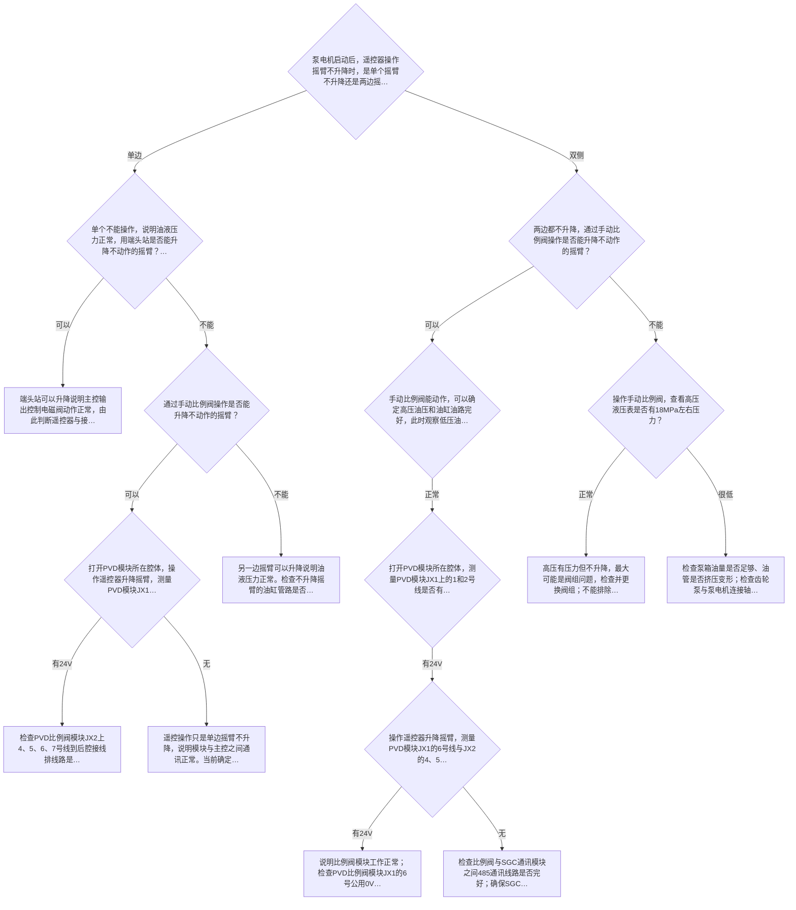
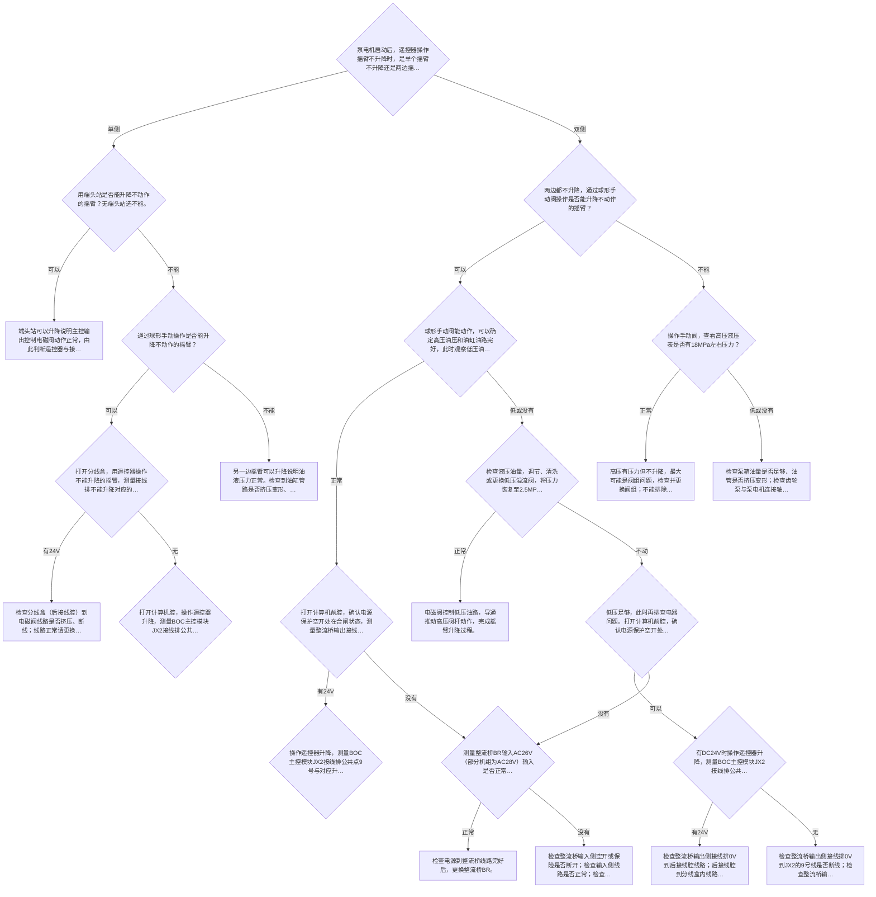
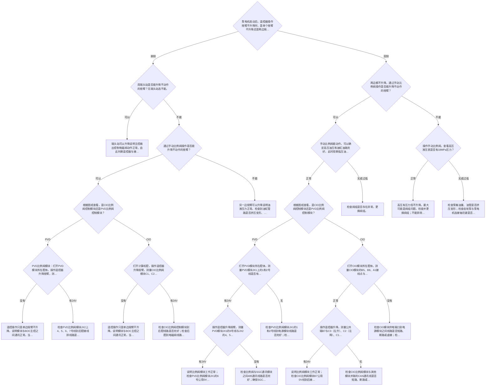
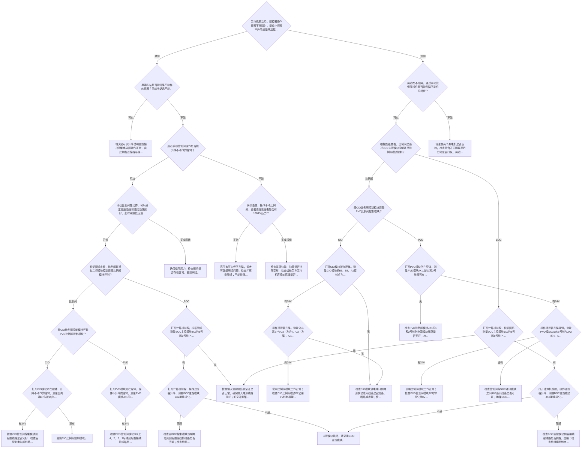
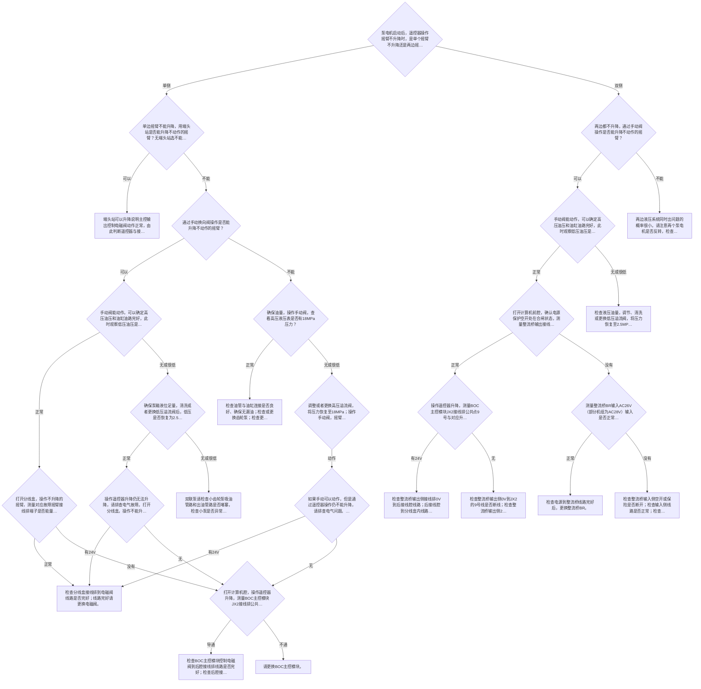

# 采煤机调高故障诊断树
> 由六段小程序录屏提取。业务逻辑以 `diagnosis-trees.yaml` 为准；本文件便于人工阅读和复核。
## 使用说明
- `observed`：录屏直接确认。
- `inferred_from_backtracking`：录屏快速返回，结合前后页面确认。
- `inferred_from_technical_logic`：录屏未完整展示，按同类页面及技术语义补齐，建议人工复核。
- `unresolved_not_recorded`：录屏缺失或原小程序点击后不跳转，必须保留 TODO。

## 1. 单泵比例阀小煤机
- 源录屏：`调高故障单比例阀小煤机.mp4`
- 起始节点：`q01`

### q01｜问题
泵电机启动后，遥控器操作摇臂不升降时，是单个摇臂不升降还是两边摇臂都不升降？

来源：`P003`，约 `14.9s`。

| 选项 | 下一节点 | 状态 |
|---|---|---|
| 单边 | `q02` | `observed` |
| 双侧 | `q05` | `observed` |

### q02｜问题
单个不能操作，说明油液压力正常，用端头站是否能升降不动作的摇臂？无端头站选不能。

来源：`P004`，约 `25.7s`。

| 选项 | 下一节点 | 状态 |
|---|---|---|
| 可以 | `r01` | `inferred_from_backtracking` |
| 不能 | `q03` | `inferred_from_backtracking` |

### r01｜结论
端头站可以升降说明主控输出控制电磁阀动作正常，由此判断遥控器与接收模块通讯正常，遥控器内部存在部分功能损坏，请更换遥控器。

来源：`P005`，约 `34.1s`。

### q03｜问题
通过手动比例阀操作是否能升降不动作的摇臂？

来源：`P006`，约 `49.6s`。

| 选项 | 下一节点 | 状态 |
|---|---|---|
| 可以 | `q04` | `observed` |
| 不能 | `r04` | `observed` |

### q04｜问题
打开PVD模块所在腔体，操作遥控器升降摇臂，测量PVD模块JX1的6号线与JX2的4、5、6、7号线对应点位之间是否量到24V？

来源：`P007`，约 `58.9s`。

| 选项 | 下一节点 | 状态 |
|---|---|---|
| 有24V | `r02` | `observed` |
| 无 | `r03` | `observed` |

### r02｜结论
检查PVD比例阀模块JX2上4、5、6、7号线到后腔接线排线路是否完好；检查后腔接线排到不升降电磁阀的线路是否完好；线路正常请更换不升降的电磁阀。

来源：`P008`，约 `65.0s`。

备注：原页面个别字样疑似存在录入错字，已按技术语义规范化。

### r03｜结论
遥控操作只是单边摇臂不升降，说明模块与主控之间通讯正常。当前确定PVD比例阀控制模块局部端口损坏，请更换PVD比例阀控制模块。

来源：`P009`，约 `73.7s`。

### r04｜结论
另一边摇臂可以升降说明油液压力正常。检查不升降摇臂的油缸管路是否挤压变形、漏油；检查油缸内泄或循环；检查平衡阀或液力锁损坏；阀组可能存在故障。

来源：`P010`，约 `80.8s`。

### q05｜问题
两边都不升降，通过手动比例阀操作是否能升降不动作的摇臂？

来源：`P011`，约 `93.0s`。

| 选项 | 下一节点 | 状态 |
|---|---|---|
| 可以 | `q06` | `observed` |
| 不能 | `q09` | `observed` |

### q06｜问题
手动比例阀能动作，可以确定高压油压和油缸油路完好，此时观察低压油压是否有2.5MPa压力？

来源：`P012`，约 `100.1s`。

| 选项 | 下一节点 | 状态 |
|---|---|---|
| 正常 | `q07` | `observed` |
| 没有 | **TODO** | `unresolved_not_recorded` |

> 没有：录屏中未展示该选项的下一页，禁止由模型自行猜测。

### q07｜问题
打开PVD模块所在腔体，测量PVD模块JX1上的1和2号线是否有24V？

来源：`P013`，约 `107.5s`。

| 选项 | 下一节点 | 状态 |
|---|---|---|
| 有24V | `q08` | `observed` |
| 无 | **TODO** | `unresolved_not_recorded` |

> 无：录屏中未展示该选项的下一页，禁止由模型自行猜测。

### q08｜问题
操作遥控器升降摇臂，测量PVD模块JX1的6号线与JX2的4、5、6、7号线对应点位之间是否量到24V？

来源：`P014`，约 `115.8s`。

| 选项 | 下一节点 | 状态 |
|---|---|---|
| 有24V | `r05` | `observed` |
| 无 | `r06` | `inferred_from_backtracking` |

### r05｜结论
说明比例阀模块工作正常；检查PVD比例阀模块JX1的6号公用0V线到后接线腔连接是否存在断路或虚接。

来源：`P015`，约 `122.2s`。

### r06｜结论
检查比例阀与SGC通讯模块之间485通讯线路是否完好；确保SGC模块与BOC主控模块之间通讯正常；如线路和通讯均正常，请更换PVD比例控制模块。

来源：`P016`，约 `125.8s`。

### q09｜问题
操作手动比例阀，查看高压液压表是否有18MPa左右压力？

来源：`P017`，约 `141.9s`。

| 选项 | 下一节点 | 状态 |
|---|---|---|
| 正常 | `r07` | `observed` |
| 很低 | `r08` | `observed` |

### r07｜结论
高压有压力但不升降，最大可能是阀组问题，检查并更换阀组；不能排除两边液力锁或平衡阀同时损坏的情况。

来源：`P018`，约 `149.5s`。

### r08｜结论
检查泵箱油量是否足够、油管是否挤压变形；检查齿轮泵与泵电机连接轴花键是否脱落；检查并更换阀组；检查以上问题并恢复高压，确保手动升降摇臂正常。

来源：`P019`，约 `155.1s`。

### Mermaid 概览

## 2. 单泵普通阀小煤机
- 源录屏：`调高故障单泵普通阀小煤机.mp4`
- 起始节点：`q01`

### q01｜问题
泵电机启动后，遥控器操作摇臂不升降时，是单个摇臂不升降还是两边摇臂都不升降？

来源：`P003`，约 `14.2s`。

| 选项 | 下一节点 | 状态 |
|---|---|---|
| 单侧 | `q02` | `observed` |
| 双侧 | `q06` | `observed` |

### q02｜问题
用端头站是否能升降不动作的摇臂？无端头站选不能。

来源：`P004`，约 `23.8s`。

| 选项 | 下一节点 | 状态 |
|---|---|---|
| 可以 | `r01` | `inferred_from_backtracking` |
| 不能 | `q03` | `inferred_from_backtracking` |

### r01｜结论
端头站可以升降说明主控输出控制电磁阀动作正常，由此判断遥控器与接收模块通讯正常，遥控器内部存在部分功能损坏，请更换遥控器。

来源：`P005`，约 `29.1s`。

### q03｜问题
通过球形手动操作是否能升降不动作的摇臂？

来源：`P006`，约 `36.2s`。

| 选项 | 下一节点 | 状态 |
|---|---|---|
| 可以 | `q04` | `observed` |
| 不能 | `r03` | `observed` |

### q04｜问题
打开分线盒，用遥控器操作不能升降的摇臂，测量接线排不能升降对应的电磁阀接线点，是否可以量到DC24V？无分线盒请打开后接线腔测量。

来源：`P007`，约 `45.8s`。

| 选项 | 下一节点 | 状态 |
|---|---|---|
| 有24V | `r02` | `observed` |
| 无 | `q05` | `observed` |

### r02｜结论
检查分线盒（后接线腔）到电磁阀线路是否挤压、断线；线路正常请更换电磁阀。

来源：`P008`，约 `51.8s`。

### q05｜问题
打开计算机腔，操作遥控器升降，测量BOC主控模块JX2接线排公共点8号与对应输出的4、5、6、7号线之间继电器触点是否导通？导通时会有继电器动作的声音。

来源：`P009`，约 `58.2s`。

备注：原小程序在录屏中对两个选项均未发生页面跳转。

| 选项 | 下一节点 | 状态 |
|---|---|---|
| 导通 | **TODO** | `unresolved_not_recorded` |

> 导通：录屏中点击后页面未发生跳转。
| 不通 | **TODO** | `unresolved_not_recorded` |

> 不通：录屏中点击后页面未发生跳转。

### r03｜结论
另一边摇臂可以升降说明油液压力正常。检查到油缸管路是否挤压变形、漏油；检查油缸内泄或循环；检查平衡阀或者液力锁损坏；阀组可能存在故障。

来源：`P010`，约 `75.4s`。

### q06｜问题
两边都不升降，通过球形手动阀操作是否能升降不动作的摇臂？

来源：`P011`，约 `85.3s`。

| 选项 | 下一节点 | 状态 |
|---|---|---|
| 可以 | `q07` | `observed` |
| 不能 | `q13` | `observed` |

### q07｜问题
球形手动阀能动作，可以确定高压油压和油缸油路完好，此时观察低压油压是否有2.5MPa压力？

来源：`P012`，约 `94.8s`。

| 选项 | 下一节点 | 状态 |
|---|---|---|
| 正常 | `q08` | `observed` |
| 低或没有 | `q11` | `observed` |

### q08｜问题
打开计算机前腔，确认电源保护空开处在合闸状态，测量整流桥输出接线排是否可以量到DC24V？

来源：`P013`，约 `104.6s`。

| 选项 | 下一节点 | 状态 |
|---|---|---|
| 有24V | `q09` | `observed` |
| 没有 | `q10` | `observed` |

### q09｜问题
操作遥控器升降，测量BOC主控模块JX2接线排公共点9号与对应升降的4、5、6、7号线之间节点是否有DC24V？

来源：`P014`，约 `113.9s`。

| 选项 | 下一节点 | 状态 |
|---|---|---|
| 有 | **TODO** | `unresolved_not_recorded` |

> 有：录屏中未展示该选项的下一页，禁止由模型自行猜测。
| 无 | **TODO** | `unresolved_not_recorded` |

> 无：录屏中未展示该选项的下一页，禁止由模型自行猜测。

### q10｜问题
测量整流桥BR输入AC26V（部分机组为AC28V）输入是否正常？

来源：`P015`，约 `128.1s`。

| 选项 | 下一节点 | 状态 |
|---|---|---|
| 正常 | `r04` | `observed` |
| 没有 | `r05` | `observed` |

### r04｜结论
检查电源到整流桥线路完好后，更换整流桥BR。

来源：`P016`，约 `133.6s`。

### r05｜结论
检查整流桥输入侧空开或保险是否断开；检查输入侧线路是否正常；检查控制变压器的输出，无输出请更换控制变压器。

来源：`P017`，约 `135.9s`。

备注：录屏中P024出现了同义重复页面，已合并。

### q11｜问题
检查液压油量，调节、清洗或更换低压溢流阀，将压力恢复至2.5MPa；用遥控器操作摇臂是否能动作？

来源：`P018`，约 `147.1s`。

| 选项 | 下一节点 | 状态 |
|---|---|---|
| 正常 | `r06` | `observed` |
| 不动 | `q12` | `observed` |

### r06｜结论
电磁阀控制低压油路，导通推动高压阀杆动作，完成摇臂升降过程。

来源：`P019`，约 `152.1s`。

### q12｜问题
低压足够，此时再排查电器问题。打开计算机前腔，确认电源保护空开处在合闸状态，测量整流桥输出接线排是否可以量到DC24V？

来源：`P020`，约 `156.9s`。

| 选项 | 下一节点 | 状态 |
|---|---|---|
| 可以 | `q14` | `observed` |
| 没有 | `q10` | `observed` |

### q14｜问题
有DC24V时操作遥控器升降，测量BOC主控模块JX2接线排公共点9号与对应升降4、5、6、7号线之间节点是否有DC24V？

来源：`P021`，约 `164.7s`。

| 选项 | 下一节点 | 状态 |
|---|---|---|
| 有24V | `r07` | `observed` |
| 无 | `r08` | `observed` |

### r07｜结论
检查整流桥输出侧接线排0V到后接线腔线路；后接线腔到分线盒内线路是否断路和虚接。

来源：`P022`，约 `169.4s`。

### r08｜结论
检查整流桥输出侧接线排0V到JX2的9号线是否断线；检查整流桥输出侧24V到JX2的8号线是否完好；以上线路正常且遥控器操作升降时无继电器响声，请更换BOC主控模块。

来源：`P023`，约 `172.4s`。

### q13｜问题
操作手动阀，查看高压液压表是否有18MPa左右压力？

来源：`P025`，约 `198.7s`。

| 选项 | 下一节点 | 状态 |
|---|---|---|
| 正常 | `r09` | `observed` |
| 低或没有 | `r10` | `observed` |

### r09｜结论
高压有压力但不升降，最大可能是阀组问题，检查并更换阀组；不能排除两边液力锁或平衡阀同时损坏的情况。

来源：`P026`，约 `204.5s`。

### r10｜结论
检查泵箱油量是否足够、油管是否挤压变形；检查齿轮泵与泵电机连接轴花键是否脱落；检查并更换阀组；检查以上问题并恢复高压，确保手动升降摇臂正常。

来源：`P027`，约 `207.9s`。

### Mermaid 概览

## 3. 单泵普通阀大煤机
- 源录屏：`单泵普通阀大煤机.mp4`
- 起始节点：`q01`

### q01｜问题
泵电机启动后，遥控器操作摇臂不升降时，是单个摇臂不升降还是两边摇臂都不升降？

来源：`P003`，约 `13.5s`。

| 选项 | 下一节点 | 状态 |
|---|---|---|
| 单侧 | `q02` | `observed` |
| 双侧 | `q06` | `observed` |

### q02｜问题
单边摇臂不能升降，说明油液压力正常；用端头站是否能升降不动作的摇臂？无端头站选不能。

来源：`P004`，约 `22.4s`。

| 选项 | 下一节点 | 状态 |
|---|---|---|
| 可以 | `r01` | `observed` |
| 不能 | `q03` | `observed` |

### r01｜结论
端头站可以升降说明主控输出控制电磁阀动作正常，由此判断遥控器与接收模块通讯正常，遥控器内部存在部分功能损坏，请更换遥控器。

来源：`P005`，约 `27.5s`。

### q03｜问题
通过手动换向阀操作是否能升降不动作的摇臂？

来源：`P006`，约 `32.2s`。

| 选项 | 下一节点 | 状态 |
|---|---|---|
| 可以 | `q04` | `observed` |
| 不能 | `r04` | `observed` |

### q04｜问题
打开分线盒，用遥控器操作不能升降的摇臂，测量接线排不能升降对应电磁阀接线点，是否可以量到DC24V？

来源：`P007`，约 `39.4s`。

| 选项 | 下一节点 | 状态 |
|---|---|---|
| 有24V | `r02` | `observed` |
| 没有 | `q05` | `observed` |

### r02｜结论
检查分线盒到电磁阀线路是否挤压、断线；线路正常请更换电磁阀。

来源：`P008`，约 `43.7s`。

### q05｜问题
打开计算机腔，操作遥控器升降，测量主控模块JX2接线排公共点8号与对应输出的4、5、6、7号线之间继电器触点是否导通？导通时会有继电器动作的声音。

来源：`P009`，约 `50.0s`。

| 选项 | 下一节点 | 状态 |
|---|---|---|
| 导通 | `r03` | `inferred_from_technical_logic` |
| 不通 | `r05` | `observed` |

### r03｜结论
检查BOC主控模块控制电磁阀到后腔接线排线路是否完好；检查后腔接线排到电磁阀线路是否完好；线路完好请更换电磁阀。

来源：`P010`，约 `55.8s`。

### r04｜结论
另一边摇臂可以升降说明油液压力正常。检查到油缸管路是否挤压变形、漏油；检查油缸内泄或循环；检查平衡阀或液力锁损坏；阀组可能存在故障。

来源：`P012`，约 `65.5s`。

### r05｜结论
请更换BOC主控模块。

来源：`P011`，约 `57.7s`。

### q06｜问题
两边都不升降，通过手动阀操作是否能升降不动作的摇臂？

来源：`P013`，约 `74.6s`。

| 选项 | 下一节点 | 状态 |
|---|---|---|
| 可以 | `q07` | `observed` |
| 不能 | `q19` | `observed` |

### q07｜问题
手动换向阀能动作，可以确定高压油压和油缸油路完好，此时观察低压油压是否有2.5MPa压力？

来源：`P014`，约 `82.9s`。

| 选项 | 下一节点 | 状态 |
|---|---|---|
| 正常 | `q08` | `observed` |
| 无或过低 | `q16` | `observed` |

### q08｜问题
低压正常的情况下，先判断总阀是否动作。操作遥控器升降摇臂，观察总阀阀杆是否动作？

来源：`P015`，约 `90.8s`。

| 选项 | 下一节点 | 状态 |
|---|---|---|
| 动作 | `q09` | `observed` |
| 不动 | `q11` | `observed` |

### q09｜问题
总阀可以动作，说明电磁阀电源正常、低压也完好。排查其他阀动作情况：打开分线盒，用遥控器操作不能升降的摇臂，测量接线排对应电磁阀接线点是否可以量到DC24V？

来源：`P016`，约 `98.0s`。

| 选项 | 下一节点 | 状态 |
|---|---|---|
| 有24V | `r02` | `observed` |
| 无 | `q10` | `observed` |

### q10｜问题
打开计算机腔，测量BOC主控模块操作遥控器升降时，JX2接线排公共点8号与对应输出4、5、6、7号线之间继电器触点是否导通？

来源：`P017`，约 `109.5s`。

| 选项 | 下一节点 | 状态 |
|---|---|---|
| 导通 | `r03` | `inferred_from_technical_logic` |
| 不通 | `r05` | `observed` |

### q11｜问题
打开分线盒，用遥控器操作摇臂升降，测量总阀电磁阀在对应接线排上是否可以量到DC24V？

来源：`P018`，约 `129.9s`。

| 选项 | 下一节点 | 状态 |
|---|---|---|
| 有24V | `r06` | `observed` |
| 无 | `q12` | `observed` |

### r06｜结论
检查分线盒到总阀线路，线路正常更换总阀电磁阀；电磁阀线路正常仍不动作请更换阀组。

来源：`P019`，约 `134.3s`。

### q12｜问题
打开计算机前腔，确认电源保护空开处在合闸状态，测量整流桥输出接线排是否可以量到DC24V？

来源：`P020`，约 `139.8s`。

| 选项 | 下一节点 | 状态 |
|---|---|---|
| 有24V | `q13` | `observed` |
| 无 | `q15` | `observed` |

### q13｜问题
说明整流桥输出电源正常，测量从整流桥输出侧的DC0V接线排到分线盒内接线排的公共DC0V线路是否通路？

来源：`P021`，约 `147.6s`。

| 选项 | 下一节点 | 状态 |
|---|---|---|
| 正常 | `q14` | `observed` |
| 不通 | `r09` | `observed` |

### q14｜问题
用遥控器轮流操作所有摇臂升降功能，测量EIO主控扩展模块JX2接线排公共点8号与对应总阀控制的3号线之间继电器触点是否都导通？

来源：`P022`，约 `157.4s`。

| 选项 | 下一节点 | 状态 |
|---|---|---|
| 正常 | `q15b` | `observed` |
| 不通 | `r08` | `observed` |

### q15b｜问题
可以确定EIO主控扩展模块完好。操作遥控器升降，测量BOC主控模块JX2接线排公共点8号与对应升降的4、5、6、7号线之间继电器触点是否导通？

来源：`P023`，约 `168.6s`。

| 选项 | 下一节点 | 状态 |
|---|---|---|
| 正常 | `r07` | `observed` |
| 不通 | `r05` | `observed` |

### r07｜结论
其他阀不动作：检查整流桥输出侧DC24V、DC0V接线排到BOC主控模块JX2的8号和9号线是否断路或虚接；总阀不动作：检查整流桥输出侧DC24V、DC0V接线排到主控模块JX2相关端子是否断路或虚接。

来源：`P024`，约 `175.5s`。

### r08｜结论
检查EIO模块与BOC主控之间CAN通讯线路；确保主控扩展模块供电正常；以上均完好请更换EIO主控扩展模块。

来源：`P025`，约 `184.3s`。

### r09｜结论
打开后腔接线腔，检查处理从整流桥输出侧DC0V接线排到后接线腔线路是否断路、虚接；检查处理后接线腔到分线盒内接线排的公共DC0V线路是否断路、虚接。

来源：`P026`，约 `191.1s`。

### q15｜问题
测量整流桥BR输入AC26V（部分机组为AC28V）输入是否正常？

来源：`P027`，约 `202.3s`。

| 选项 | 下一节点 | 状态 |
|---|---|---|
| 正常 | `r10` | `observed` |
| 无 | `r11` | `observed` |

### r10｜结论
检查电源到整流桥线路完好后，更换整流桥BR。

来源：`P028`，约 `211.2s`。

### r11｜结论
检查整流桥输入侧空开或保险是否断开；检查输入侧线路是否正常；检查控制变压器输出，无输出请更换控制变压器。

来源：`P029`，约 `213.1s`。

### q16｜问题
检查液压油量，调节、清洗或更换低压溢流阀，将压力恢复至2.5MPa；用遥控器操作摇臂是否能动作？

来源：`P030`，约 `230.7s`。

| 选项 | 下一节点 | 状态 |
|---|---|---|
| 动作 | `r12` | `observed` |
| 不动 | `q17` | `observed` |

### r12｜结论
电磁阀控制低压油路，导通推动高压阀杆动作，完成摇臂升降过程。

来源：`P031`，约 `236.7s`。

### q17｜问题
低压足够，此时再排查电器问题。低压正常的情况下先判断总阀是否动作，操作遥控器升降摇臂，观察总阀阀杆是否动作？

来源：`P032`，约 `243.0s`。

备注：该跳转按录屏实际路径记录。

| 选项 | 下一节点 | 状态 |
|---|---|---|
| 动作 | `q13` | `observed` |
| 不动 | `q15` | `observed` |

### q19｜问题
操作手动阀，查看高压液压表是否有18MPa左右压力？

来源：`P033`，约 `313.0s`。

| 选项 | 下一节点 | 状态 |
|---|---|---|
| 正常 | `r13` | `observed` |
| 无或过低 | `q20` | `observed` |

### r13｜结论
高压有压力但不升降，最大可能是阀组问题，检查并更换阀组；不能排除两边液力锁或平衡阀同时损坏的情况。

来源：`P034`，约 `319.6s`。

### q20｜问题
调整或者更换高压溢流阀，将压力恢复至18MPa；操作手动阀，摇臂是否动作？

来源：`P035`，约 `323.2s`。

| 选项 | 下一节点 | 状态 |
|---|---|---|
| 动作 | `q21` | `observed` |
| 不动 | **TODO** | `unresolved_not_recorded` |

> 不动：录屏中未展示该选项的下一页，禁止由模型自行猜测。

### q21｜问题
手动可以动作，但通过遥控器操作仍不能升降，请排查电气问题。低压正常的情况下先判断总阀是否动作：操作遥控器升降摇臂，观察总阀阀杆是否动作？

来源：`P036`，约 `328.3s`。

| 选项 | 下一节点 | 状态 |
|---|---|---|
| 动作 | `q09` | `observed` |
| 不动 | `q11` | `observed` |

### Mermaid 概览

```mermaid
flowchart TD
q01{"泵电机启动后，遥控器操作摇臂不升降时，是单个摇臂不升降还是两边摇…"}
q02{"单边摇臂不能升降，说明油液压力正常；用端头站是否能升降不动作的摇…"}
r01["端头站可以升降说明主控输出控制电磁阀动作正常，由此判断遥控器与接…"]
q03{"通过手动换向阀操作是否能升降不动作的摇臂？"}
q04{"打开分线盒，用遥控器操作不能升降的摇臂，测量接线排不能升降对应电…"}
r02["检查分线盒到电磁阀线路是否挤压、断线；线路正常请更换电磁阀。"]
q05{"打开计算机腔，操作遥控器升降，测量主控模块JX2接线排公共点8号…"}
r03["检查BOC主控模块控制电磁阀到后腔接线排线路是否完好；检查后腔接…"]
r04["另一边摇臂可以升降说明油液压力正常。检查到油缸管路是否挤压变形、…"]
r05["请更换BOC主控模块。"]
q06{"两边都不升降，通过手动阀操作是否能升降不动作的摇臂？"}
q07{"手动换向阀能动作，可以确定高压油压和油缸油路完好，此时观察低压油…"}
q08{"低压正常的情况下，先判断总阀是否动作。操作遥控器升降摇臂，观察总…"}
q09{"总阀可以动作，说明电磁阀电源正常、低压也完好。排查其他阀动作情况…"}
q10{"打开计算机腔，测量BOC主控模块操作遥控器升降时，JX2接线排公…"}
q11{"打开分线盒，用遥控器操作摇臂升降，测量总阀电磁阀在对应接线排上是…"}
r06["检查分线盒到总阀线路，线路正常更换总阀电磁阀；电磁阀线路正常仍不…"]
q12{"打开计算机前腔，确认电源保护空开处在合闸状态，测量整流桥输出接线…"}
q13{"说明整流桥输出电源正常，测量从整流桥输出侧的DC0V接线排到分线…"}
q14{"用遥控器轮流操作所有摇臂升降功能，测量EIO主控扩展模块JX2接…"}
q15b{"可以确定EIO主控扩展模块完好。操作遥控器升降，测量BOC主控模…"}
r07["其他阀不动作：检查整流桥输出侧DC24V、DC0V接线排到BOC…"]
r08["检查EIO模块与BOC主控之间CAN通讯线路；确保主控扩展模块供…"]
r09["打开后腔接线腔，检查处理从整流桥输出侧DC0V接线排到后接线腔线…"]
q15{"测量整流桥BR输入AC26V（部分机组为AC28V）输入是否正常…"}
r10["检查电源到整流桥线路完好后，更换整流桥BR。"]
r11["检查整流桥输入侧空开或保险是否断开；检查输入侧线路是否正常；检查…"]
q16{"检查液压油量，调节、清洗或更换低压溢流阀，将压力恢复至2.5MP…"}
r12["电磁阀控制低压油路，导通推动高压阀杆动作，完成摇臂升降过程。"]
q17{"低压足够，此时再排查电器问题。低压正常的情况下先判断总阀是否动作…"}
q19{"操作手动阀，查看高压液压表是否有18MPa左右压力？"}
r13["高压有压力但不升降，最大可能是阀组问题，检查并更换阀组；不能排除…"]
q20{"调整或者更换高压溢流阀，将压力恢复至18MPa；操作手动阀，摇臂…"}
q21{"手动可以动作，但通过遥控器操作仍不能升降，请排查电气问题。低压正…"}
q01 -- "单侧" --> q02
q01 -- "双侧" --> q06
q02 -- "可以" --> r01
q02 -- "不能" --> q03
q03 -- "可以" --> q04
q03 -- "不能" --> r04
q04 -- "有24V" --> r02
q04 -- "没有" --> q05
q05 -- "导通" --> r03
q05 -- "不通" --> r05
q06 -- "可以" --> q07
q06 -- "不能" --> q19
q07 -- "正常" --> q08
q07 -- "无或过低" --> q16
q08 -- "动作" --> q09
q08 -- "不动" --> q11
q09 -- "有24V" --> r02
q09 -- "无" --> q10
q10 -- "导通" --> r03
q10 -- "不通" --> r05
q11 -- "有24V" --> r06
q11 -- "无" --> q12
q12 -- "有24V" --> q13
q12 -- "无" --> q15
q13 -- "正常" --> q14
q13 -- "不通" --> r09
q14 -- "正常" --> q15b
q14 -- "不通" --> r08
q15b -- "正常" --> r07
q15b -- "不通" --> r05
q15 -- "正常" --> r10
q15 -- "无" --> r11
q16 -- "动作" --> r12
q16 -- "不动" --> q17
q17 -- "动作" --> q13
q17 -- "不动" --> q15
q19 -- "正常" --> r13
q19 -- "无或过低" --> q20
q20 -- "动作" --> q21
q21 -- "动作" --> q09
q21 -- "不动" --> q11
```

## 4. 单泵比例阀大煤机
- 源录屏：`单泵比例阀大煤机.mp4`
- 起始节点：`q01`

### q01｜问题
泵电机启动后，遥控器操作摇臂不升降时，是单个摇臂不升降还是两边摇臂都不升降？

来源：`P001`，约 `6.1s`。

| 选项 | 下一节点 | 状态 |
|---|---|---|
| 单侧 | `q02` | `observed` |
| 双侧 | `q08` | `observed` |

### q02｜问题
用端头站是否能升降不动作的摇臂？无端头站选不能。

来源：`P002`，约 `15.0s`。

| 选项 | 下一节点 | 状态 |
|---|---|---|
| 可以 | `r01` | `observed` |
| 不能 | `q03` | `observed` |

### r01｜结论
端头站可以升降说明主控输出控制电磁阀动作正常，由此判断遥控器与接收模块通讯正常，遥控器内部存在部分功能损坏，请更换遥控器。

来源：`P003`，约 `20.8s`。

### q03｜问题
通过手动比例阀操作是否能升降不动作的摇臂？

来源：`P004`，约 `25.2s`。

| 选项 | 下一节点 | 状态 |
|---|---|---|
| 可以 | `q04` | `observed` |
| 不能 | `r06` | `observed` |

### q04｜问题
根据图纸查看，是CIO比例阀控制模块还是PVD比例阀控制模块？

来源：`P005`，约 `32.1s`。

备注：该页面在单侧与双侧路径中复用，但下一节点不同；结构化数据中已拆分上下文。

| 选项 | 下一节点 | 状态 |
|---|---|---|
| PVD | `q05` | `observed` |
| CIO | `q06` | `observed` |

### q05｜问题
PVD比例阀模块：打开PVD模块所在腔体，操作遥控器升降摇臂，测量PVD模块JX1的6号线与JX2的4、5、6、7号线对应点位之间是否量到24V？

来源：`P006`，约 `40.5s`。

| 选项 | 下一节点 | 状态 |
|---|---|---|
| 没有 | `r02` | `observed` |
| 有24V | `r03` | `observed` |

### r02｜结论
遥控操作只是单边摇臂不升降，说明模块与BOC主控之间通讯正常。当前确定PVD比例阀控制模块局部端口损坏，请更换比例阀控制模块。

来源：`P007`，约 `46.0s`。

### r03｜结论
检查PVD比例阀模块JX2上4、5、6、7号线到后腔接线排线路是否完好；检查后腔接线排到不升降电磁阀线路是否完好；线路正常请更换不升降的电磁阀。

来源：`P008`，约 `49.2s`。

### q06｜问题
打开计算机腔，操作遥控器升降摇臂，测量CIO比例阀模块C1、C2、C3、B1接线点与公共点B7-0V之间是否有DC24V输出？

来源：`P009`，约 `56.8s`。

| 选项 | 下一节点 | 状态 |
|---|---|---|
| 没有 | `r04` | `observed` |
| 有24V | `r05` | `observed` |

### r04｜结论
遥控操作只是单边摇臂不升降，说明模块与BOC主控之间通讯正常。当前确定CIO比例阀控制模块局部端口损坏，请更换比例阀控制模块。

来源：`P010`，约 `61.8s`。

### r05｜结论
检查CIO比例阀控制模块到后腔线路是否完好；检查后腔到电磁阀线路是否完好；以上线路完好，请更换不动作的电磁阀。

来源：`P011`，约 `64.5s`。

### r06｜结论
另一边摇臂可以升降说明油液压力正常。检查到油缸管路是否挤压变形、漏油；检查油缸内泄或循环；检查平衡阀或者液力锁损坏；阀组可能存在故障。

来源：`P012`，约 `70.3s`。

### q08｜问题
两边都不升降，通过手动比例阀操作是否能升降不动作的摇臂？

来源：`P013`，约 `78.3s`。

| 选项 | 下一节点 | 状态 |
|---|---|---|
| 可以 | `q09` | `observed` |
| 不能 | `q16` | `observed` |

### q09｜问题
手动比例阀能动作，可以确定高压油压和油缸油路完好，此时观察低压油压是否有2.5MPa压力？

来源：`P014`，约 `86.7s`。

| 选项 | 下一节点 | 状态 |
|---|---|---|
| 正常 | `q10` | `observed` |
| 无或过低 | `r12` | `observed` |

### q10｜问题
根据图纸查看，是CIO比例阀控制模块还是PVD比例阀控制模块？

来源：`P005`，约 `32.1s`。

| 选项 | 下一节点 | 状态 |
|---|---|---|
| PVD | `q11` | `observed` |
| CIO | `q13` | `observed` |

### q11｜问题
打开PVD模块所在腔体，测量PVD模块JX1上的1和2号线是否有24V？

来源：`P015`，约 `101.8s`。

| 选项 | 下一节点 | 状态 |
|---|---|---|
| 有24V | `q12` | `observed` |
| 无 | `r09` | `observed` |

### q12｜问题
操作遥控器升降摇臂，测量PVD模块JX1的6号线与JX2的4、5、6、7号线对应点位之间是否量到24V？

来源：`P016`，约 `111.4s`。

| 选项 | 下一节点 | 状态 |
|---|---|---|
| 有24V | `r07` | `observed` |
| 没有 | `r08` | `observed` |

### r07｜结论
说明比例阀模块工作正常；检查PVD比例阀模块JX1的6号公用0V线到后接线腔连接是否存在断路或虚接。

来源：`P017`，约 `118.7s`。

### r08｜结论
检查比例阀与SGC通讯模块之间485通讯线路是否完好；确保SGC模块与BOC主控模块之间通讯正常；如线路和通讯均正常，请更换PVD比例控制模块。

来源：`P018`，约 `121.0s`。

### r09｜结论
检查PVD比例阀模块JX1的1和2号线到电源模块线路是否完好；检查电源模块供电电源线路正常，确保电源模块输入输出空开闭合；甩开输出侧，有输入无输出请更换电源模块。

来源：`P019`，约 `125.0s`。

### q13｜问题
打开CIO模块所在腔体，测量CIO模块的B5、B8、A1接线点与B7接线是否有24V供电？

来源：`P020`，约 `129.1s`。

| 选项 | 下一节点 | 状态 |
|---|---|---|
| 正常 | `q14` | `observed` |
| 没有 | `r11` | `observed` |

### q14｜问题
操作遥控器升降，测量公共端B7与C3（左升）、C2（左降）、C1（右升）、B1（右降）之间是否有24V？

来源：`P021`，约 `135.2s`。

| 选项 | 下一节点 | 状态 |
|---|---|---|
| 有24V | `r10` | `observed` |
| 无 | `r11b` | `observed` |

### r10｜结论
说明比例阀模块工作正常；检查CIO比例阀模块B7公用0V线到后接线腔线路，以及后腔到分线盒内的连接是否存在断路或虚接。

来源：`P022`，约 `141.2s`。

### r11b｜结论
检查CIO比例阀模块与其他模块并联的CAN通讯线是否短路、断路或虚接；线路无问题请更换CIO比例阀控制模块。

来源：`P023`，约 `144.5s`。

### r11｜结论
检查CIO模块供电端口到电源模块之间线路是否短路、断路或虚接；检查电源模块供电电源线路正常，确保电源模块输入输出空开闭合；甩开输出侧，有输入无输出请更换电源模块。

来源：`P024`，约 `148.6s`。

### r12｜结论
检查阀组是否存在异常，更换阀组。

来源：`P025`，约 `155.4s`。

### q16｜问题
操作手动比例阀，查看高压液压表是否有18MPa压力？

来源：`P026`，约 `166.0s`。

| 选项 | 下一节点 | 状态 |
|---|---|---|
| 正常 | `r13` | `observed` |
| 无或过低 | `r14` | `observed` |

### r13｜结论
高压有压力但不升降，最大可能是阀组问题，检查并更换阀组；不能排除两边液力锁或平衡阀同时损坏的情况。

来源：`P027`，约 `172.4s`。

### r14｜结论
检查泵箱油量、油管是否挤压变形；检查齿轮泵与泵电机连接轴花键是否脱落；检查并更换阀组；检查以上问题并恢复高压，确保手动升降摇臂正常。

来源：`P028`，约 `175.1s`。

### Mermaid 概览

## 5. 双泵比例阀煤机
- 源录屏：`双泵比例阀煤机.mp4`
- 起始节点：`q01`

### q01｜问题
泵电机启动后，遥控器操作摇臂不升降时，是单个摇臂不升降还是两边摇臂都不升降？

来源：`P000`，约 `4.0s`。

| 选项 | 下一节点 | 状态 |
|---|---|---|
| 单侧 | `q02` | `observed` |
| 双侧 | `q14` | `observed` |

### q02｜问题
用端头站是否能升降不动作的摇臂？无端头站选不能。

来源：`P001`，约 `10.4s`。

| 选项 | 下一节点 | 状态 |
|---|---|---|
| 可以 | `r01` | `observed` |
| 不能 | `q03` | `observed` |

### r01｜结论
端头站可以升降说明主控输出控制电磁阀动作正常，由此判断遥控器与接收模块通讯正常，遥控器内部存在部分功能损坏，请更换遥控器。

来源：`P002`，约 `13.8s`。

### q03｜问题
通过手动比例阀操作是否能升降不动作的摇臂？

来源：`P003`，约 `18.2s`。

| 选项 | 下一节点 | 状态 |
|---|---|---|
| 可以 | `q04` | `observed` |
| 不能 | `q12` | `observed` |

### q04｜问题
手动比例阀能动作，可以确定高压油压和油缸油路完好，此时观察低压油压是否有2.5MPa压力？

来源：`P004`，约 `23.5s`。

| 选项 | 下一节点 | 状态 |
|---|---|---|
| 正常 | `q05` | `observed` |
| 无或很低 | `r10` | `observed` |

### q05｜问题
根据图纸查看，比例阀是通过主控模块控制还是比例阀模块控制？

来源：`P005`，约 `29.0s`。

| 选项 | 下一节点 | 状态 |
|---|---|---|
| 比例阀 | `q06` | `observed` |
| BOC | `q09` | `observed` |

### q06｜问题
是CIO比例阀控制模块还是PVD比例阀控制模块？

来源：`P006`，约 `34.5s`。

| 选项 | 下一节点 | 状态 |
|---|---|---|
| CIO | `q07` | `observed` |
| PVD | `q08` | `observed` |

### q07｜问题
打开CIO模块所在腔体，升降不动作的摇臂，测量公共端B7与所对应C3（左升）、C2（左降）、C1（右升）、B1（右降）之间是否有24V？

来源：`P007`，约 `40.2s`。

| 选项 | 下一节点 | 状态 |
|---|---|---|
| 有24V | `r02` | `observed` |
| 没有 | `r03` | `observed` |

### r02｜结论
检查CIO比例阀控制模块到后腔线路是否完好；检查后腔到电磁阀线路是否完好；以上线路完好请更换不动作的电磁阀。

来源：`P008`，约 `44.4s`。

### r03｜结论
更换CIO比例阀控制模块。

来源：`P009`，约 `46.1s`。

### q08｜问题
打开PVD模块所在腔体，操作不升降的摇臂，测量PVD模块JX1的6号线与升降对应JX2的4、5、6、7号线点位之间是否量到24V？

来源：`P010`，约 `52.1s`。

| 选项 | 下一节点 | 状态 |
|---|---|---|
| 有24V | `r04` | `observed` |
| 没有 | **TODO** | `unresolved_not_recorded` |

> 没有：录屏中未展示该选项的下一页，禁止由模型自行猜测。

### r04｜结论
检查PVD比例阀模块JX2上4、5、6、7号线到后腔接线排线路是否完好；检查后腔接线排到不升降电磁阀线路是否完好；线路正常请更换不升降的电磁阀。

来源：`P011`，约 `55.7s`。

### q09｜问题
打开计算机前腔，根据图纸测量BOC主控模块JX2的8号和9号线上是否有DC24V电源？（个别煤机为DC12V）

来源：`P012`，约 `64.8s`。

| 选项 | 下一节点 | 状态 |
|---|---|---|
| 有 | `q10` | `observed` |
| 无 | `r07` | `observed` |

### q10｜问题
打开计算机前腔，操作遥控器升降，测量BOC主控模块JX2接线排公共点8号与对应升降4、5、6、7号线之间继电器触点是否导通？导通时会有继电器动作的声音。

来源：`P013`，约 `70.0s`。

| 选项 | 下一节点 | 状态 |
|---|---|---|
| 导通 | `r05` | `observed` |
| 不通 | `r06` | `observed` |

### r05｜结论
检查主BOC控制模块控制电磁阀到后腔接线排线路是否完好；检查后腔接线排到电磁阀线路是否完好；线路完好请更换电磁阀。

来源：`P014`，约 `73.4s`。

### r06｜结论
主控模块损坏，请更换BOC主控模块。

来源：`P015`，约 `75.8s`。

### r07｜结论
检查输入侧和输出侧空开是否正常，确保输入电源线路完好；如空开频繁跳开或保险频繁烧坏，线路上存在短路；确保电磁阀电源模块输入正常后，请更换电磁阀电源模块。

来源：`P016`，约 `79.6s`。

### r10｜结论
确保低压压力，检查阀组是否存在异常，更换阀组。

来源：`P017`，约 `86.2s`。

### q12｜问题
确保油量，操作手动比例阀，查看高压液压表是否有18MPa压力？

来源：`P018`，约 `93.6s`。

| 选项 | 下一节点 | 状态 |
|---|---|---|
| 正常 | `r08` | `observed` |
| 无或很低 | `r09` | `observed` |

### r08｜结论
高压有压力但不升降，最大可能是阀组问题，检查并更换阀组；不能排除两边液力锁或平衡阀同时损坏的情况。

来源：`P019`，约 `98.7s`。

### r09｜结论
检查泵箱油量、油管是否挤压变形；检查齿轮泵与泵电机连接轴花键是否脱落；检查并更换阀组；阀组可能存在故障。

来源：`P020`，约 `100.8s`。

### q14｜问题
两边都不升降，通过手动比例阀操作是否能升降不动作的摇臂？

来源：`P021`，约 `108.2s`。

| 选项 | 下一节点 | 状态 |
|---|---|---|
| 可以 | `q15` | `observed` |
| 不能 | `r17` | `observed` |

### q15｜问题
根据图纸查看，比例阀是通过BOC主控模块控制还是比例阀模块控制？

来源：`P022`，约 `114.3s`。

| 选项 | 下一节点 | 状态 |
|---|---|---|
| 比例阀 | `q16` | `observed` |
| BOC | `q09_double` | `observed` |

### q16｜问题
是CIO比例阀控制模块还是PVD比例阀控制模块？

来源：`P006`，约 `34.5s`。

| 选项 | 下一节点 | 状态 |
|---|---|---|
| CIO | `q17` | `observed` |
| PVD | `q19` | `observed` |

### q17｜问题
打开CIO模块所在腔体，测量CIO模块的B5、B8、A1接线点与B7接线是否有24V供电？

来源：`P028`，约 `148.9s`。

| 选项 | 下一节点 | 状态 |
|---|---|---|
| 有24V | `q18` | `observed` |
| 无 | `r14` | `observed` |

### q18｜问题
操作遥控器升降，测量公共端B7与C3（左升）、C2（左降）、C1（右升）、B1（右降）之间是否有24V？

来源：`P029`，约 `153.7s`。

| 选项 | 下一节点 | 状态 |
|---|---|---|
| 有24V | `r11` | `observed` |
| 无 | `r14` | `inferred_from_recorded_backtracking` |

### r11｜结论
说明比例阀模块工作正常；检查CIO比例阀模块B7公用0V线到后接线腔线路，以及后腔到分线盒内的连接是否存在断路或虚接。

来源：`P030`，约 `157.4s`。

### r14｜结论
检查CIO模块供电端口到电源模块之间线路是否短路、断路或虚接；检查电源模块供电电源线路正常，确保电源模块输入输出空开闭合；甩开输出侧，有输入无输出请更换电源模块。

来源：`P031`，约 `162.4s`。

### q19｜问题
打开PVD模块所在腔体，测量PVD模块JX1上的1和2号线是否有24V？

来源：`P023`，约 `125.4s`。

| 选项 | 下一节点 | 状态 |
|---|---|---|
| 有24V | `q20` | `observed` |
| 无 | `r16` | `observed` |

### q20｜问题
操作遥控器升降摇臂，测量PVD模块JX1的6号线与JX2的4、5、6、7号线对应点位之间是否量到24V？

来源：`P024`，约 `130.4s`。

| 选项 | 下一节点 | 状态 |
|---|---|---|
| 有24V | `r12` | `observed` |
| 没有 | `r13` | `observed` |

### r12｜结论
说明比例阀模块工作正常；检查PVD比例阀模块JX1的6号公用0V线到后接线腔连接是否存在断路或虚接。

来源：`P025`，约 `133.9s`。

### r13｜结论
检查比例阀与SGC通讯模块之间485通讯线路是否完好；确保SGC模块与BOC主控模块之间通讯正常；如线路和通讯均正常，请更换PVD比例控制模块。

来源：`P026`，约 `137.2s`。

### r16｜结论
检查PVD比例阀模块JX1的1和2号线到电源模块线路是否完好；检查电源模块供电电源线路正常，确保电源模块输入输出空开闭合；甩开输出侧，有输入无输出请更换电源模块。

来源：`P027`，约 `142.0s`。

### r15｜结论
检查BOC主控模块到后接线腔线路是否断路、虚接；检查后接线腔到电磁阀线路，线路正常请更换电磁阀或阀组。

来源：`P032`，约 `181.0s`。

### r17｜结论
请注意两个泵电机是否反转，检查组合开关隔离手把方向是否打反；两边阀组同时出问题概率很小，检查高压压力，恢复手动升降操作后再排查电气问题。

来源：`P033`，约 `195.5s`。

### q10_double｜问题
打开计算机前腔，操作遥控器升降，测量BOC主控模块JX2接线排公共点8号与对应升降4、5、6、7号线之间继电器触点是否导通？导通时会有继电器动作的声音。

来源：`P013`，约 `70.0s`。

备注：双侧路径中的同一可视页面，按录屏上下文拆分。

| 选项 | 下一节点 | 状态 |
|---|---|---|
| 导通 | `r15` | `observed` |
| 不通 | `r06` | `observed` |

### q09_double｜问题
打开计算机前腔，根据图纸测量BOC主控模块JX2的8号和9号线上是否有DC24V电源？（个别煤机为DC12V）

来源：`P012`，约 `64.8s`。

备注：双侧路径中的同一可视页面，按录屏上下文拆分。

| 选项 | 下一节点 | 状态 |
|---|---|---|
| 有 | `q10_double` | `observed` |
| 无 | `r07` | `observed` |

### Mermaid 概览

## 6. 双泵普通阀煤机
- 源录屏：`双泵普通阀电机.mp4`
- 起始节点：`q01`

### q01｜问题
泵电机启动后，遥控器操作摇臂不升降时，是单个摇臂不升降还是两边摇臂都不升降？

来源：`P000`，约 `8.9s`。

| 选项 | 下一节点 | 状态 |
|---|---|---|
| 单侧 | `q02` | `observed` |
| 双侧 | `q10` | `observed` |

### q02｜问题
单边摇臂不能升降，用端头站是否能升降不动作的摇臂？无端头站选不能。

来源：`P001`，约 `20.6s`。

| 选项 | 下一节点 | 状态 |
|---|---|---|
| 可以 | `r01` | `observed` |
| 不能 | `q03` | `observed` |

### r01｜结论
端头站可以升降说明主控输出控制电磁阀动作正常，由此判断遥控器与接收模块通讯正常，遥控器内部存在部分功能损坏，请更换遥控器。

来源：`P002`，约 `23.9s`。

### q03｜问题
通过手动换向阀操作是否能升降不动作的摇臂？

来源：`P003`，约 `28.3s`。

| 选项 | 下一节点 | 状态 |
|---|---|---|
| 可以 | `q04` | `observed` |
| 不能 | `q08` | `observed` |

### q04｜问题
手动阀能动作，可以确定高压油压和油缸油路完好，此时观察低压油压是否有2.5MPa压力？

来源：`P004`，约 `35.3s`。

| 选项 | 下一节点 | 状态 |
|---|---|---|
| 正常 | `q05` | `observed` |
| 无或很低 | `q07` | `observed` |

### q05｜问题
打开分线盒，操作不升降的摇臂，测量对应故障摇臂接线排端子是否能量到DC24V？

来源：`P005`，约 `43.2s`。

| 选项 | 下一节点 | 状态 |
|---|---|---|
| 正常 | `r02` | `observed` |
| 没有 | `q06` | `observed` |

### r02｜结论
检查分线盒接线排到电磁阀线路是否完好；线路完好请更换电磁阀。

来源：`P006`，约 `48.1s`。

### q06｜问题
打开计算机腔，操作遥控器升降，测量BOC主控模块JX2接线排公共点8号与对应输出4、5、6、7号线之间继电器触点是否导通？导通时会有继电器动作的声音。

来源：`P007`，约 `52.3s`。

| 选项 | 下一节点 | 状态 |
|---|---|---|
| 导通 | `r03` | `observed` |
| 不通 | `r04` | `observed` |

### r03｜结论
检查BOC主控模块控制电磁阀到后腔接线排线路是否完好；检查后腔接线排到分线盒线路是否完好；线路完好请更换电磁阀。

来源：`P008`，约 `56.6s`。

### r04｜结论
请更换BOC主控模块。

来源：`P009`，约 `58.5s`。

### q07｜问题
确保泵箱液位足量，清洗或者更换低压溢流阀后，低压是否恢复为2.5MPa？

来源：`P010`，约 `71.0s`。

| 选项 | 下一节点 | 状态 |
|---|---|---|
| 正常 | `q07b` | `observed` |
| 无或很低 | `r05` | `observed` |

### q07b｜问题
操作遥控器升降仍无法升降，请排查电气故障。打开分线盒，操作不能升降的摇臂，测量对应接线排是否能量到DC24V？

来源：`P011`，约 `77.8s`。

| 选项 | 下一节点 | 状态 |
|---|---|---|
| 有24V | `r02` | `observed` |
| 无 | `q06` | `observed` |

### r05｜结论
双联泵请检查小齿轮泵吸油管路和出油管路是否堵塞，检查小泵是否异常；排查阀组故障后再试。

来源：`P012`，约 `106.3s`。

### q08｜问题
确保油量，操作手动阀，查看高压液压表是否有18MPa压力？

来源：`P013`，约 `116.0s`。

| 选项 | 下一节点 | 状态 |
|---|---|---|
| 正常 | `r06` | `observed` |
| 无或很低 | `q09` | `observed` |

### r06｜结论
检查油管与油缸连接是否良好、确保无漏油；检查或更换齿轮泵；检查更换平衡阀或液力锁堵塞。

来源：`P014`，约 `120.2s`。

### q09｜问题
调整或者更换高压溢流阀，将压力恢复至18MPa；操作手动阀，摇臂是否动作？

来源：`P015`，约 `124.0s`。

| 选项 | 下一节点 | 状态 |
|---|---|---|
| 动作 | `q09b` | `observed` |
| 不动 | **TODO** | `unresolved_not_recorded` |

> 不动：录屏中未展示该选项的下一页，禁止由模型自行猜测。

### q09b｜问题
如果手动可以动作，但是通过遥控器操作仍不能升降，请排查电气问题。打开分线盒，操作不能升降的摇臂，测量对应接线排是否能量到DC24V？

来源：`P016`，约 `129.2s`。

| 选项 | 下一节点 | 状态 |
|---|---|---|
| 有24V | `r02` | `observed` |
| 无 | `q06` | `observed` |

### q10｜问题
两边都不升降，通过手动阀操作是否能升降不动作的摇臂？

来源：`P017`，约 `156.2s`。

| 选项 | 下一节点 | 状态 |
|---|---|---|
| 可以 | `q11` | `observed` |
| 不能 | `r11` | `observed` |

### q11｜问题
手动阀能动作，可以确定高压油压和油缸油路完好，此时观察低压油压是否有2.5MPa压力？

来源：`P004`，约 `35.3s`。

| 选项 | 下一节点 | 状态 |
|---|---|---|
| 正常 | `q12` | `observed` |
| 无或很低 | `r10` | `observed` |

### q12｜问题
打开计算机前腔，确认电源保护空开处在合闸状态，测量整流桥输出接线排是否可以量到DC24V？

来源：`P018`，约 `172.1s`。

| 选项 | 下一节点 | 状态 |
|---|---|---|
| 正常 | `q13` | `observed` |
| 没有 | `q14` | `observed` |

### q13｜问题
操作遥控器升降，测量BOC主控模块JX2接线排公共点9号与对应升降4、5、6、7号线之间节点是否有DC24V？

来源：`P019`，约 `179.4s`。

| 选项 | 下一节点 | 状态 |
|---|---|---|
| 有24V | `r07` | `observed` |
| 无 | `r08` | `observed` |

### r07｜结论
检查整流桥输出侧接线排0V到后接线腔线路；后接线腔到分线盒内线路是否断路和虚接。

来源：`P020`，约 `183.7s`。

### r08｜结论
检查整流桥输出侧0V到JX2的9号线是否断线；检查整流桥输出侧24V到JX2的8号线是否完好；以上线路正常且遥控器操作升降时无继电器响声，请更换BOC主控模块。

来源：`P021`，约 `185.6s`。

### q14｜问题
测量整流桥BR输入AC26V（部分机组为AC28V）输入是否正常？

来源：`P022`，约 `191.9s`。

| 选项 | 下一节点 | 状态 |
|---|---|---|
| 正常 | `r09` | `observed` |
| 没有 | `r09b` | `observed` |

### r09｜结论
检查电源到整流桥线路完好后，更换整流桥BR。

来源：`P023`，约 `195.2s`。

### r09b｜结论
检查整流桥输入侧空开或保险是否断开；检查输入侧线路是否正常；检查控制变压器输出，无输出请更换控制变压器。

来源：`P024`，约 `196.8s`。

### r10｜结论
检查液压油量，调节、清洗或更换低压溢流阀，将压力恢复至2.5MPa；用遥控器操作摇臂仍不能升降时，请排查电气问题。

来源：`P025`，约 `201.0s`。

### r11｜结论
两边液压系统同时出问题的概率很小。请注意两个泵电机是否反转，检查组合开关隔离手把方向是否打反；确保手动可以升降摇臂后再排查电气问题。

来源：`P026`，约 `204.6s`。

### Mermaid 概览

